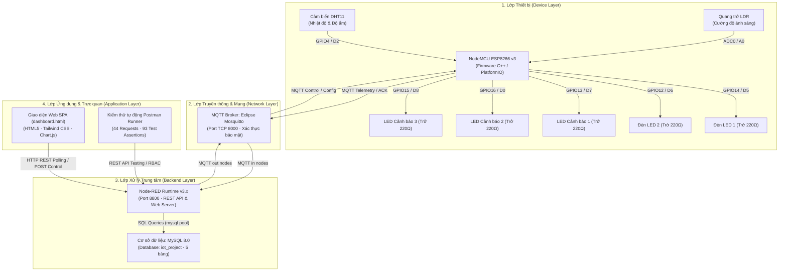
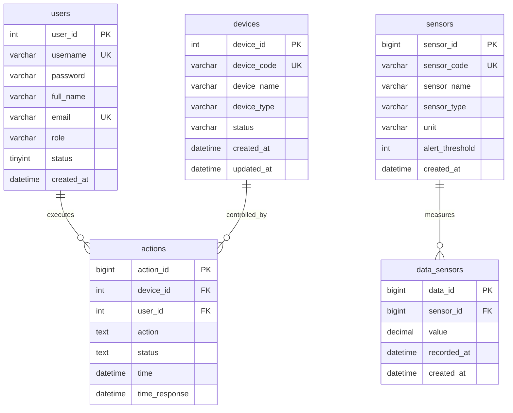

# HỆ THỐNG CẢM BIẾN GIÁM SÁT MÔI TRƯỜNG VÀ ĐIỀU KHIỂN THIẾT BỊ IOT
> **Học phần**: IoT và Ứng dụng (Mã học phần: **INT14149**)  
> **Khoa**: An toàn Thông tin — **Học viện Công nghệ Bưu chính Viễn thông (PTIT)**  
> **Sinh viên thực hiện**: **Triệu Nguyễn Minh Tân** (MSV: **B23DCAT271** - Lớp: **D23CQAT01-B**)  
> **Kiến trúc cốt lõi**: NodeMCU ESP8266 · Mosquitto MQTT (Port 8000) · Node-RED Backend (Port 8800) · MySQL 8.0 · Web Dashboard SPA · Postman Automated Testing

---

## 📌 LIÊN KẾT BÁO CÁO & NỘP BÀI

| Hạng mục | Nền tảng / Định dạng | Liên kết trực tiếp |
|---|---|---|
| **Mã nguồn dự án (GitHub)** | GitHub Repository | [trieunguyenminhtan-ops/iot_project](https://github.com/trieunguyenminhtan-ops/iot_project) |
| **Tài liệu API (Postman)** | Postman Published Docs | [Postman API Documentation](https://documenter.getpostman.com/view/59265981/2sBYHVwKD2) |
| **Bản thiết kế giao diện (Figma)** | Figma Prototype & UI | [Figma Design - IOT Project](https://www.figma.com/design/aspO5tDv2OblazGS3toX3F/IOT_figma?node-id=0-1&t=caShhlYFYGxx9peV-1) |
| **Báo cáo đặc tả hệ thống (SRS)** | PDF Document | [Báo cáo SRS (Google Drive)](https://drive.google.com/file/d/15XEHZ1aj5_eXvdZRVXRdJlNcZaLGECRm/view?usp=sharing) |

---

## 🏗️ TỔNG QUAN KIẾN TRÚC HỆ THỐNG

Hệ thống được xây dựng theo mô hình phân tầng chuyên biệt (**Multi-tier IoT Architecture**) kết hợp luồng xử lý hướng sự kiện (**Event-driven Architecture**), đảm bảo tính thời gian thực, tách biệt trách nhiệm và độ tin cậy cao:



### 🔄 Các luồng dữ liệu cốt lõi:

* **1. Luồng thu thập dữ liệu (Telemetry Stream):**
  > `Cảm biến (DHT11, LDR)` ➔ *(định kỳ 5s/lần)* ➔ `NodeMCU ESP8266` ➔ *(MQTT: data/sensor)* ➔ `Mosquitto Broker` ➔ `Node-RED` ➔ *(INSERT SQL)* ➔ `MySQL` ➔ *(GET /api/dashboard)* ➔ `Web SPA (Card & Chart)`

* **2. Luồng cảm biến giả lập & cảnh báo ngưỡng (Random & Warning Stream):**
  > `NodeMCU ESP8266` ➔ *(random s1: 0..10, s2: 0..100, s3: 0..1000)* ➔ `MQTT: data/random` ➔ `Node-RED` ➔ *(INSERT SQL data_sensors)* ➔ `GET /api/warnings` ➔ `Web SPA (Tab Cảnh báo 3x3: số đo, biểu đồ, box LED nháy)`  
  > *(Đồng thời: nếu giá trị > 50% max, LED tương ứng D7, D0, D8 trên phần cứng nháy chu kỳ ~300ms bằng millis())*

* **3. Luồng điều khiển thiết bị có phản hồi xác nhận (Control & ACK Stream):**
  > `Thao tác Web / REST API` ➔ *(POST /api/control)* ➔ `Node-RED (actions: pending)` ➔ *(MQTT: device/control/*)` ➔ `NodeMCU (thực thi chân GPIO)` ➔ *(device/response)* ➔ `Node-RED (actions: success, response_ms)` ➔ `Web SPA (Đồng bộ công tắc)`

---

## 🔌 SƠ ĐỒ ĐẤU NỐI PHẦN CỨNG (PINOUT)

| Linh kiện | Chân linh kiện | Chân NodeMCU v3 | Vai trò kỹ thuật & Ràng buộc phần cứng |
|---|---|---|---|
| **Cảm biến DHT11** | `VCC` / `GND` / `DATA` | `3V3` / `GND` / **`D2`** (GPIO4) | Đo Nhiệt độ (°C) và Độ ẩm (%), chu kỳ lấy mẫu 5s/lần |
| **Quang trở LDR** | `VCC` / `GND` / `AO` | `3V3` / `GND` / **`A0`** (ADC0) | Đo cường độ ánh sáng, dải ADC: 0 – 1023 |
| **Đèn LED 1** | (+) Anode / (-) Cathode | **`D5`** (GPIO14) / `GND` | Thiết bị chấp hành 1 (mắc nối tiếp điện trở hạn dòng 220Ω) |
| **Đèn LED 2** | (+) Anode / (-) Cathode | **`D6`** (GPIO12) / `GND` | Thiết bị chấp hành 2 (mắc nối tiếp điện trở hạn dòng 220Ω) |
| **LED Cảnh báo 1** | (+) Anode / (-) Cathode | **`D7`** (GPIO13) / `GND` | Nháy cảnh báo khi cảm biến 1 > 5 (nối tiếp trở 220Ω) |
| **LED Cảnh báo 2** | (+) Anode / (-) Cathode | **`D0`** (GPIO16) / `GND` | Nháy cảnh báo khi cảm biến 2 > 50 (nối tiếp trở 220Ω, chỉ dùng `digitalWrite`, không dùng PWM/ngắt) |
| **LED Cảnh báo 3** | (+) Anode / (-) Cathode | **`D8`** (GPIO15) / `GND` | Nháy cảnh báo khi cảm biến 3 > 500 (nối tiếp trở 220Ω, **ràng buộc: GPIO15 phải ở mức LOW lúc boot nên chỉ nối cathode về GND qua trở 220Ω, tuyệt đối không dùng pull-up**) |
| **Nguồn cấp & Nạp** | Cáp Micro-USB | Cổng **`COM6`** | Cấp nguồn 5V/1A, giao tiếp nối tiếp Serial Baudrate **115200** |

---

## 📡 GIAO THỨC TRUYỀN THÔNG MQTT (PORT 8000)

* **MQTT Broker**: Eclipse Mosquitto v2.x (Cổng TCP `8000`).
* **Xác thực**: Hỗ trợ xác thực bảo mật tài khoản người dùng (cấu hình trong `secrets.h` và file mật khẩu của Mosquitto Broker).

### Danh mục Topic MQTT trong hệ thống:

| Topic | Chiều truyền | QoS | Nội dung Payload JSON / Chuỗi | Mô tả chi tiết |
|---|---|:---:|---|---|
| `data/sensor` | NodeMCU → Broker | 0 | `{"temp": 28.5, "hum": 65.0, "light": 320}` | Gửi định kỳ 5s/lần thông số nhiệt độ, độ ẩm, ánh sáng |
| `data/random` | NodeMCU → Broker | 0 | `{"s1": 6, "s2": 90, "s3": 300}` | Gửi định kỳ 5s/lần giá trị 3 cảm biến giả lập (s1: 0..10, s2: 0..100, s3: 0..1000) |
| `device/control/led1` | Node-RED / CLI → NodeMCU | 1 | `ON` hoặc `OFF` | Lệnh điều khiển độc lập Đèn LED 1 |
| `device/control/led2` | Node-RED / CLI → NodeMCU | 1 | `ON` hoặc `OFF` | Lệnh điều khiển độc lập Đèn LED 2 |
| `device/control/all` | Node-RED / CLI → NodeMCU | 1 | `{"led1":"ON","led2":"OFF"}` | Lệnh điều khiển đồng thời cả 2 đèn trong 1 bản tin duy nhất |
| `device/response` | NodeMCU → Broker | 0 | `{"id": 1, "device": "led1", "state": "ON", "status": "success"}` | Bản tin phản hồi xác nhận (ACK) kết quả thực thi |
| `device/config/threshold` | Node-RED → NodeMCU | 1 (Retain) | `{"t1": 5, "t2": 50, "t3": 500}` | Cấu hình ngưỡng cảnh báo cho 3 cảm biến ngẫu nhiên (QoS 1, retain để giữ cấu hình sau reset) |
| `device/response` (LWT) | Broker → Node-RED | 0 | `{"id": 0, "device": "node", "state": "OFFLINE", "status": "success"}` | Thông điệp di chúc (Last Will and Testament) kích hoạt khi NodeMCU mất nguồn đột ngột |

---

## 🗄️ THIẾT KẾ CƠ SỞ DỮ LIỆU (MYSQL `iot_project`)

Hệ thống lưu trữ trên **MySQL Community Server 8.0** gồm 5 bảng chuẩn hóa theo mô hình quan hệ ERD:



### Danh mục Cảm biến trong bảng `sensors`:
1. **ID 1**: `DHT11_TEMP` — Cảm biến Nhiệt độ (`temperature`, đơn vị: `°C`)
2. **ID 2**: `DHT11_HUM` — Cảm biến Độ ẩm (`humidity`, đơn vị: `%`)
3. **ID 3**: `LDR_LIGHT` — Cảm biến Ánh sáng (`light`, đơn vị: `lux`)
4. **ID 4**: `RND1` — Cảm biến Ngẫu nhiên 1 (`random`, dải 0..10, ngưỡng 5, đơn vị: `đv`)
5. **ID 5**: `RND2` — Cảm biến Ngẫu nhiên 2 (`random`, dải 0..100, ngưỡng 50, đơn vị: `%`)
6. **ID 6**: `RND3` — Cảm biến Ngẫu nhiên 3 (`random`, dải 0..1000, ngưỡng 500, đơn vị: `pts`)

### Quản lý Migration Idempotent:
Các script migration được lưu trữ tại thư mục `database/migrations/` (thiết kế idempotent, chạy lặp lại an toàn không báo lỗi):
1. **Migration 001** (Thêm 3 cảm biến ngẫu nhiên `RND1`, `RND2`, `RND3`):
   ```sql
   mysql -u iot -p iot_project < database/migrations/001_add_random_sensors.sql
   ```
2. **Migration 002** (Thêm cột `alert_threshold` và gán ngưỡng mặc định 5, 50, 500):
   ```sql
   mysql -u iot -p iot_project < database/migrations/002_add_alert_threshold.sql
   ```

---

## 🌐 DANH MỤC RESTFUL API (NODE-RED BACKEND PORT 8800)

| Phương thức | Đường dẫn API | Chức năng nghiệp vụ | Quyền truy cập | Mã trạng thái HTTP |
|:---:|---|---|:---:|:---:|
| `POST` | `/api/login` | Đăng nhập tài khoản, sinh Bearer Token lưu phiên | Công khai | `200 OK`, `400 Bad`, `401 Unauth` |
| `POST` | `/api/logout` | Đăng xuất phiên làm việc hiện tại, hủy token | Đã đăng nhập | `200 OK`, `401 Unauth` |
| `GET` | `/api/me` | Lấy thông tin tài khoản đang kết nối | Đã đăng nhập | `200 OK`, `401 Unauth` |
| `GET` | `/api/dashboard` | Lấy số liệu cảm biến mới nhất, trạng thái đèn và 20 điểm vẽ biểu đồ (alias: `/api/dashboard/summary`) | Công khai (Viewer) | `200 OK` |
| `GET` | `/api/warnings` | Lấy thông tin 3 cảm biến ngẫu nhiên, ngưỡng hiện hành, default_threshold, cờ `alert` và 20 điểm vẽ đồ thị | Admin / User | `200 OK`, `401 Unauth` |
| `PUT` | `/api/thresholds` | Tùy chỉnh ngưỡng cảnh báo: `{"RND1":5,"RND2":50,"RND3":500}` (lưu DB & phát MQTT retain) | **Admin / User** | `200 OK`, `400 Bad`, `401 Unauth`, `403 Forbidden` |
| `GET` | `/api/sensor-types` | Lấy danh mục tất cả cảm biến trong hệ thống (phục vụ bộ lọc động) | Admin / User | `200 OK`, `401 Unauth` |
| `GET` | `/api/sensors` | Tra cứu dữ liệu cảm biến (lọc theo `temperature`, `humidity`, `light`, `random`, tìm kiếm ngày giờ/giá trị, phân trang) | Admin / User | `200 OK`, `401 Unauth` |
| `GET` | `/api/actions` | Tra cứu nhật ký điều khiển: lọc thiết bị/hành động/trạng thái, phân trang | Admin / User | `200 OK`, `401 Unauth` |
| `POST` | `/api/control` | Điều khiển bật/tắt đèn: `{"device":"led1","action":"ON"}` | **Admin / User** | `200 OK`, `400 Bad`, `403 Forbidden` (Viewer), `504 Timeout` |
| `GET` | `/api/profile` | Xem thông tin hồ sơ sinh viên thực hiện đề tài | **Duy nhất Admin** | `200 OK`, `401 Unauth`, `403 Forbidden` |

---

## 🔐 MA TRẬN PHÂN QUYỀN NGƯỜI DÙNG (RBAC)

Hệ thống quản lý xác thực bằng **Bearer Token** truyền qua HTTP Header `Authorization: Bearer <token>`:

| Tính năng trên hệ thống | Khách vãng lai (`viewer`) | Người dùng tiêu chuẩn (`user`) | Quản trị viên (`admin`) |
|---|:---:|:---:|:---:|
| **Xem Dashboard (Cards & Chart)** | ✅ Cho phép xem | ✅ Cho phép xem | ✅ Cho phép xem |
| **Bật/Tắt công tắc đèn (LED 1 & LED 2)** | ❌ **Bị khóa (Disable)** | ✅ **Được điều khiển** | ✅ **Toàn quyền điều khiển** |
| **Xem màn hình Cảnh báo (Tab Cảnh báo 3x3)** | ❌ Chặn truy cập | ✅ Xem đầy đủ & Đồ thị | ✅ Toàn quyền xem |
| **Tùy chỉnh & Lưu ngưỡng cảnh báo** | ❌ **Bị khóa (Disable)** | ✅ **Được chỉnh sửa & lưu** | ✅ **Toàn quyền quản trị** |
| **Tra cứu tab Data sensor & Bộ lọc (kể cả ngẫu nhiên)** | ❌ Chặn truy cập | ✅ Tra cứu & Lọc | ✅ Toàn quyền truy vấn |
| **Tra cứu tab Action history & Lịch sử** | ❌ Chặn truy cập | ✅ Tra cứu & Lọc | ✅ Toàn quyền truy vấn |
| **Xem màn hình Profile sinh viên** | ❌ Chặn truy cập | ❌ Chặn truy cập | ✅ **Duy nhất Admin** |
| **Yêu cầu mã Bearer Token khi gọi API** | Không có token | Bắt buộc Bearer Token | Bắt buộc Bearer Token |

### Tài khoản thử nghiệm mẫu:
* **Admin**: `admin` / `admin123` (Toàn quyền quản trị hệ thống).
* **User**: `user` / `user123` (Người dùng có quyền điều khiển, xem cảnh báo và tra cứu).
* **Viewer**: Mặc định khi chưa đăng nhập hoặc bấm Đăng xuất (Chỉ xem Dashboard).

---

## 🧪 KIỂM THỬ TỰ ĐỘNG HÓA POSTMAN (93/93 TESTS PASSED)

Toàn bộ 44 kịch bản kiểm thử RESTful API được đóng gói trong collection [`docs/postman/IoT_Dashboard_API.postman_collection.json`](docs/postman/IoT_Dashboard_API.postman_collection.json). Khi thực thi tự động qua **Postman Collection Runner** / **Postman CLI**:

* **Tổng số Request:** **44 requests**
* **Tổng số kiểm thử (pm.test assertions):** **93/93 Passed (100%)**
* **Thời gian đáp ứng trung bình:** khoảng 20 ms (phản hồi tức thời)
* **Tỷ lệ lỗi (Errors/Failed):** **0%**

```text
Folder 1. Đăng nhập & Xác thực (3 requests, 6 assertions passed)
Folder 2. Dashboard (1 request, 5 assertions passed)
Folder 3. Data sensor (14 requests, 28 assertions passed - gồm lọc RND1..RND3, sensor-types 200/401)
Folder 4. Action history (10 requests, 20 assertions passed)
Folder 5. Điều khiển thiết bị (6 requests, 12 assertions passed)
Folder 6. Cảnh báo (Warnings) (7 requests, 15 assertions passed - GET warnings, PUT thresholds 200/400/401, kiểm tra ngưỡng mới, khôi phục mặc định)
Folder 7. Profile & Đăng xuất (3 requests, 7 assertions passed)
--------------------------------------------------------------------------------------
TOTAL: 44 Requests | 93 Test Assertions | 0 Failures | 0 Errors (100% Passed)
```

---

## 📂 CẤU TRÚC THƯ MỤC DỰ ÁN

```text
D:\iot-project\
├── platformio.ini                    # Cấu hình biên dịch & nạp firmware PlatformIO (ESP8266, COM6, 115200)
├── AGENTS.md                         # Quy chuẩn hệ thống & nguyên tắc dành cho Antigravity AI Agent
├── README.md                         # Tài liệu giới thiệu & hướng dẫn toàn diện của dự án
├── SRS.pdf                           # Báo cáo đặc tả yêu cầu phần mềm và kết quả thực nghiệm (50 trang)
├── SRS.docx                          # File tài liệu Word nguồn
│
├── firmware/                         # Mã nguồn nhúng vi điều khiển NodeMCU
│   ├── src/
│   │   └── main.cpp                  # Đọc DHT11, LDR, tạo 3 số random, điều khiển LED1/LED2, nháy 3 LED cảnh báo
│   └── include/
│       ├── secrets.h                 # Cấu hình thông tin mạng WiFi, MQTT Broker (nội bộ, không commit)
│       └── secrets.example.h         # Mẫu cấu hình WiFi & MQTT mẫu
│
├── database/
│   ├── migrations/
│   │   ├── 001_add_random_sensors.sql # Migration idempotent thêm 3 cảm biến ngẫu nhiên RND1..RND3
│   │   └── 002_add_alert_threshold.sql # Migration idempotent thêm cột alert_threshold và gán ngưỡng mặc định
│   └── schema.sql                    # Script tạo 5 bảng MySQL và dữ liệu mẫu đầy đủ
│
├── node-red/
│   └── flow_iot_all.json             # Toàn bộ luồng backend: MQTT subscribe data/sensor & data/random, REST API
│
├── frontend/                         # Ứng dụng Web Single Page Application (SPA)
│   ├── dashboard.html                # Giao diện chính: Dashboard, Cảnh báo 3x3, Data sensor, Action history, Profile
│   ├── architecture_diagram.html     # Sơ đồ kiến trúc tương tác trực quan
│   ├── database_diagram.html         # Sơ đồ cơ sở dữ liệu tương tác trực quan
│   └── *.svg                         # Bản vẽ kiến trúc định dạng vector
│
├── docs/                             # Tài liệu kỹ thuật dự án
│   ├── HUONG_DAN_TRIEN_KHAI.md       # Cẩm nang cài đặt và triển khai chi tiết từ A-Z trên Windows 11
│   └── postman/                      # Bộ công cụ kiểm thử tự động Postman
│       ├── IoT_Dashboard_API.postman_collection.json # 44 Requests, 93 Assertions
│       └── IoT_Localhost.postman_environment.json
│
└── scripts/windows/
    └── start-node-red.bat            # Script khởi động nhanh Node-RED backend chỉ với 1 click
```

---

## ⚡ HƯỚNG DẪN KHỞI ĐỘNG NHANH (QUICKSTART)

### 1. Chuẩn bị môi trường phần mềm
Đảm bảo máy tính đã cài đặt:
* **MySQL Community Server 8.0** (Port 3306)
* **Eclipse Mosquitto MQTT Broker v2.x** (Port 8000)
* **Node.js LTS (v20+)** và **Node-RED** (`npm install -g --unsafe-perm node-red`)
* **VS Code / Antigravity IDE** có cài extension **PlatformIO IDE**

### 2. Thiết lập Cơ sở dữ liệu MySQL
Mở Command Prompt hoặc MySQL Workbench và thực thi:
```sql
SOURCE D:/iot-project/database/schema.sql;
```
*(Nếu cơ sở dữ liệu đã tồn tại, chạy file migration: `SOURCE D:/iot-project/database/migrations/001_add_random_sensors.sql;`)*

### 3. Biên dịch và nạp Firmware lên NodeMCU
1. Cắm cáp Micro-USB nối bo mạch NodeMCU vào cổng máy tính (Ví dụ: `COM6`).
2. Mở thư mục dự án trong IDE, mở terminal chạy lệnh:
```powershell
# Biên dịch mã nguồn
& "$env:USERPROFILE\.platformio\penv\Scripts\pio.exe" run

# Nạp vào NodeMCU
& "$env:USERPROFILE\.platformio\penv\Scripts\pio.exe" run -t upload

# Mở Serial Monitor theo dõi
& "$env:USERPROFILE\.platformio\penv\Scripts\pio.exe" device monitor
```

### 4. Khởi động Backend Node-RED (Port 8800)
Nhấp đúp chuột vào file:
👉 **`D:\iot-project\scripts\windows\start-node-red.bat`**  
*(Cửa sổ dòng lệnh Node-RED sẽ chạy ngầm và lắng nghe tại cổng `8800`).*

### 5. Truy cập Giao diện Web Dashboard
Mở trình duyệt Google Chrome và truy cập:
👉 **`http://localhost:8800/dashboard.html`**

---

## 🛠️ CƠ CHẾ CHỊU LỖI & TÍNH NĂNG NỔI BẬT

1. **Cảnh báo mất kết nối NodeMCU (Heartbeat & LWT Alert):**
   * Nếu sau **10 giây** giao diện không nhận được dữ liệu cảm biến từ NodeMCU (do mất nguồn, đứt cáp hoặc mất sóng WiFi), giao diện Web lập tức xuất hiện **Thanh cảnh báo đỏ nhấp nháy (`#nodemcu-disconnect-alert`)** kèm hiệu ứng `animate-pulse`, đồng thời mờ giao diện và dừng nháy các box cảnh báo. Khi thiết bị online trở lại, thanh cảnh báo tự động ẩn đi tức thời.
2. **Cơ chế Timeout chống treo lệnh điều khiển (5000ms):**
   * Khi người dùng phát lệnh điều khiển nhưng mạch phần cứng đang offline, sau 5 giây Node-RED tự động cập nhật bản ghi trong bảng `actions` sang trạng thái `timeout`, triệt tiêu hoàn toàn lỗi kẹt trạng thái `pending` vĩnh viễn.
3. **Đồng bộ hai chiều và Khôi phục trạng thái (State Persistence):**
   * Ứng dụng lưu trữ đệm tại `localStorage`. Khi người dùng nhấn **F5 (Reload trang)**, hệ thống khôi phục trạng thái BẬT/TẮT của 2 đèn, số liệu đo cảm biến và tab làm việc đang mở ngay tức thì mà không bị trễ hay vỡ giao diện.
4. **Hỗ trợ điều khiển gộp đa kênh qua dòng lệnh (Batch Control):**
   * Cho phép gửi trực tiếp lệnh từ Terminal qua Mosquitto CLI mà không cần mở Web:
     ```cmd
     mosquitto_pub -h localhost -p 8000 -u <mqtt_user> -P <mqtt_password> -t "device/control/all" -m "{\"led1\":\"ON\",\"led2\":\"OFF\"}"
     ```
   * *(Thay thế `<mqtt_user>` và `<mqtt_password>` bằng tài khoản MQTT được cấp quyền trên Broker).*
   * Firmware và Backend tự động chuẩn hóa dấu nháy và cập nhật trạng thái đồng bộ lên cơ sở dữ liệu và màn hình điều khiển.
5. **Giả lập nhanh dữ liệu cảnh báo từ dòng lệnh (Alert Testing):**
   * Khi chưa cắm phần cứng hoặc muốn kiểm thử trực tiếp trạng thái nháy LED và đổi màu ô giá trị trên Web:
     ```cmd
     mosquitto_pub -h localhost -p 8000 -u <mqtt_user> -P <mqtt_password> -t "data/random" -m "{\"s1\":6,\"s2\":90,\"s3\":300}"
     ```
   * *Kỳ vọng:* Cảm biến 1 (6 > 5) và Cảm biến 2 (90 > 50) vượt ngưỡng 50% max ➔ LED cảnh báo 1 (D7) và LED cảnh báo 2 (D0) cùng các box tương ứng trên Web NHÁY đỏ; Cảm biến 3 (300 <= 500) ➔ LED cảnh báo 3 (D8) và box LED 3 TẮT / bình thường.
6. **Kiểm tra đồng bộ cấu hình ngưỡng qua MQTT Retained:**
   * Theo dõi luồng bản tin retained gửi cấu hình ngưỡng xuống NodeMCU:
     ```cmd
     mosquitto_sub -h localhost -p 8000 -u <mqtt_user> -P <mqtt_password> -t "device/config/threshold" -v
     ```
   * *Kỳ vọng:* Nhận ngay bản tin retained hiện có (ví dụ: `{"t1":5,"t2":50,"t3":500}`), và nhận bản tin mới tức thời mỗi khi người dùng nhấn "Lưu ngưỡng" trên giao diện Web.

---

## 👥 THÔNG TIN TÁC GIẢ & BẢN QUYỀN

* **Sinh viên thực hiện**: **Triệu Nguyễn Minh Tân**
* **Mã sinh viên**: **B23DCAT271**
* **Lớp**: **D23CQAT01-B**
* **Khoa**: An toàn Thông tin — Học viện Công nghệ Bưu chính Viễn thông (PTIT)
* **Email liên hệ**: [trieunguyenminhtan@gmail.com](mailto:trieunguyenminhtan@gmail.com)
* **Số điện thoại**: 0845620255

*Dự án được xây dựng phục vụ nghiên cứu học thuật và nghiệm thu học phần IoT và Ứng dụng (INT14149).*
