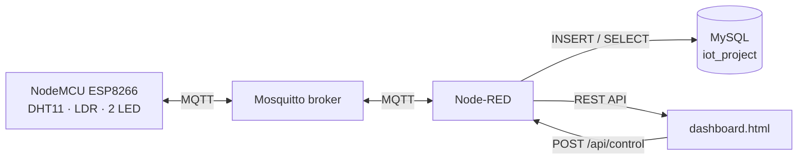

# Hệ thống giám sát và điều khiển IoT (NodeMCU · MQTT · Node-RED · MySQL)

Dự án đồ án IoT: **NodeMCU ESP8266** đọc nhiệt độ, độ ẩm (DHT11), ánh sáng (quang trở) và điều khiển 2 đèn LED.
Dữ liệu đi qua **MQTT** → **Node-RED** → lưu vào **MySQL** → hiển thị trên **giao diện web** (dashboard) theo thời gian thực.

## Liên kết nộp bài

| Hạng mục | Liên kết |
|---|---|
| GitHub | _(điền link repo)_ |
| Postman (API docs) | _(điền link published docs)_ |
| Figma (giao diện) | _(điền link Figma)_ |
| Báo cáo (PDF) | _(điền link / file `frontend/bao-cao.pdf`)_ |

## Kiến trúc



### Topic MQTT

| Topic | Chiều | Nội dung |
|---|---|---|
| `data/sensor` | NodeMCU → broker | `{"temp":28.5,"hum":65,"light":320}` (mỗi 5 giây) |
| `device/control/led1`, `device/control/led2` | giao diện/terminal → NodeMCU | `ON` hoặc `OFF` |
| `device/control/all` | giao diện/terminal → NodeMCU | `{"led1":"ON","led2":"OFF"}` (1 lệnh điều khiển nhiều đèn) |
| `device/response` | NodeMCU → broker | `{"id":1,"device":"led1","state":"ON","status":"success"}` |


## API (Node-RED)

| Method | Đường dẫn | Chức năng | Phân quyền |
|---|---|---|---|
| POST | `/api/login` | Đăng nhập hệ thống (nhận JWT/Bearer token) | Công khai |
| POST | `/api/logout` | Đăng xuất phiên làm việc | Đã đăng nhập |
| GET | `/api/me` | Lấy thông tin tài khoản hiện tại | Đã đăng nhập |
| GET | `/api/dashboard` | Số liệu mới nhất, trạng thái đèn, biểu đồ | Công khai / Xem |
| GET | `/api/sensors` | Data sensor: tìm kiếm, lọc loại cảm biến, phân trang | Công khai / Xem |
| GET | `/api/actions` | Lịch sử điều khiển: lọc thiết bị/hành động/trạng thái/thời gian, phân trang | Công khai / Xem |
| POST | `/api/control` | Bật/tắt đèn: `{"device":"led1","action":"ON"}` | **Admin / User** |
| GET | `/api/profile` | Thông tin sinh viên (bảng `users`) | Đã đăng nhập |

Tài liệu đầy đủ và ví dụ nằm trong collection Postman: [`docs/postman/`](docs/postman/).

## Phân quyền & Tài khoản mẫu

| Tài khoản | Mật khẩu | Quyền | Mô tả |
|---|---|---|---|
| `admin` | `admin123` | **admin** | Toàn quyền xem dữ liệu, điều khiển bật/tắt thiết bị |
| `user` | `user123` | **user** | Quyền bật/tắt thiết bị, xem Data sensor, Action history, Profile |
| `viewer` | `viewer123` | **viewer** | Chỉ xem Dashboard; không được điều khiển đèn và không được xem Data sensor, Action history, Profile |

## Cấu trúc thư mục

```
iot-project/
├── platformio.ini                # Cấu hình PlatformIO (mở thư mục này trong Antigravity IDE hoặc VS Code)
├── AGENTS.md                     # Quy chuẩn và ngữ cảnh cho Antigravity AI Agent
├── firmware/
│   ├── src/main.cpp              # Code NodeMCU (đọc cảm biến, điều khiển LED)
│   └── include/
│       ├── secrets.example.h     # Mẫu thông tin WiFi/MQTT  → sao chép thành secrets.h
│       └── secrets.h             # (KHÔNG có trên GitHub) thông tin thật
├── database/schema.sql           # 5 bảng: users, devices, sensors, actions, data_sensors
├── node-red/flow_iot_all.json    # Flow: ghi dữ liệu MQTT → DB, API Auth & Control
├── frontend/dashboard.html       # Giao diện web: Dashboard, Data sensor, Action history, Profile, Login modal
├── docs/
│   ├── HUONG_DAN_TRIEN_KHAI.md   # Hướng dẫn triển khai từ A-Z (Windows 11)
│   └── postman/                  # Collection + environment Postman
└── scripts/windows/start-node-red.bat
```

## Chạy nhanh

Hướng dẫn chi tiết từng bước (cài đặt, đấu nối, nạp firmware, Postman, Figma, GitHub) xem
[`docs/HUONG_DAN_TRIEN_KHAI.md`](docs/HUONG_DAN_TRIEN_KHAI.md). Tóm tắt:

1. Cài Mosquitto, MySQL 8, Node.js + Node-RED, VS Code + PlatformIO.
2. `mysql -u root -p -e "source C:/iot-project/database/schema.sql"`, tạo user `iot`.
3. Chép `firmware/include/secrets.example.h` → `secrets.h`, điền WiFi và IP máy chạy broker.
4. Mở thư mục dự án bằng VS Code → PlatformIO **Upload** lên NodeMCU.
5. Import `node-red/flow_iot_all.json` vào Node-RED, điền mật khẩu MQTT/MySQL, **Deploy**.
6. Mở `http://localhost:8800/dashboard.html`.

## Đấu nối phần cứng

| Linh kiện | Chân NodeMCU |
|---|---|
| DHT11 (VCC / GND / DATA) | 3V3 / GND / **D2** (GPIO4) |
| Cảm biến ánh sáng (VCC / GND / AO) | 3V3 / GND / **A0** |
| LED 1 (qua điện trở 220Ω) | **D5** (GPIO14) |
| LED 2 (qua điện trở 220Ω) | **D6** (GPIO12) |
